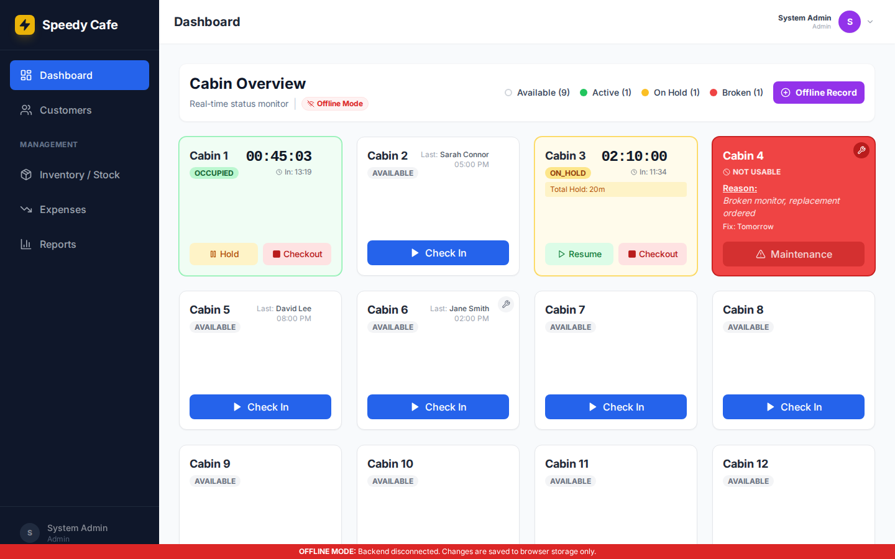
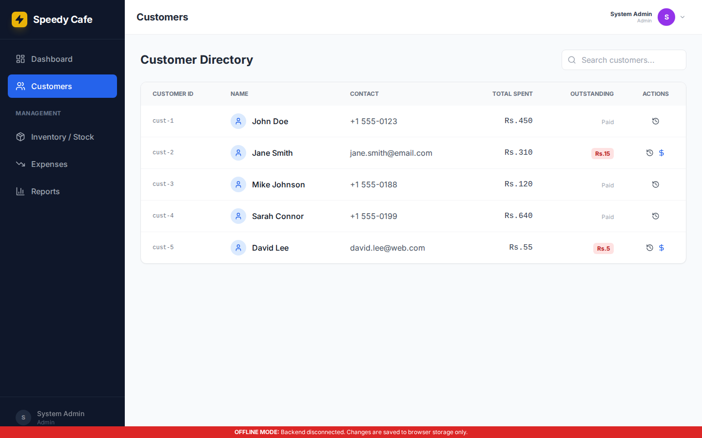
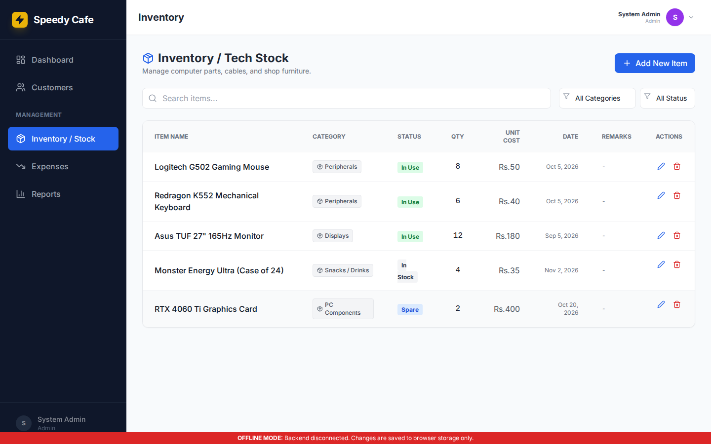
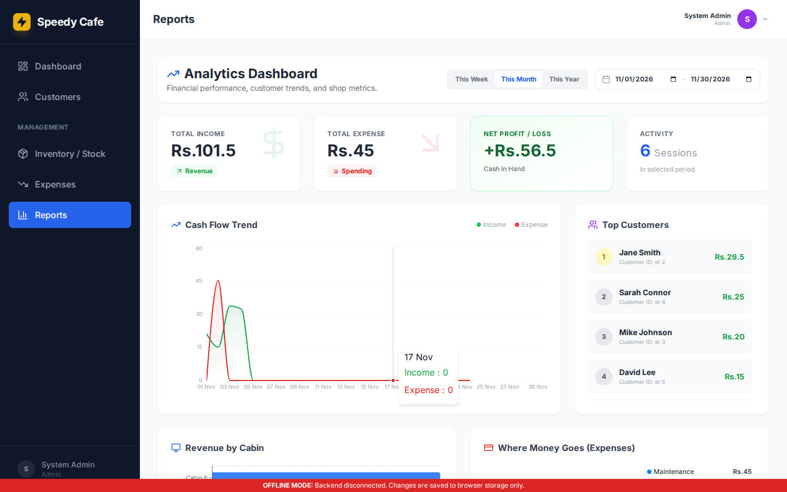
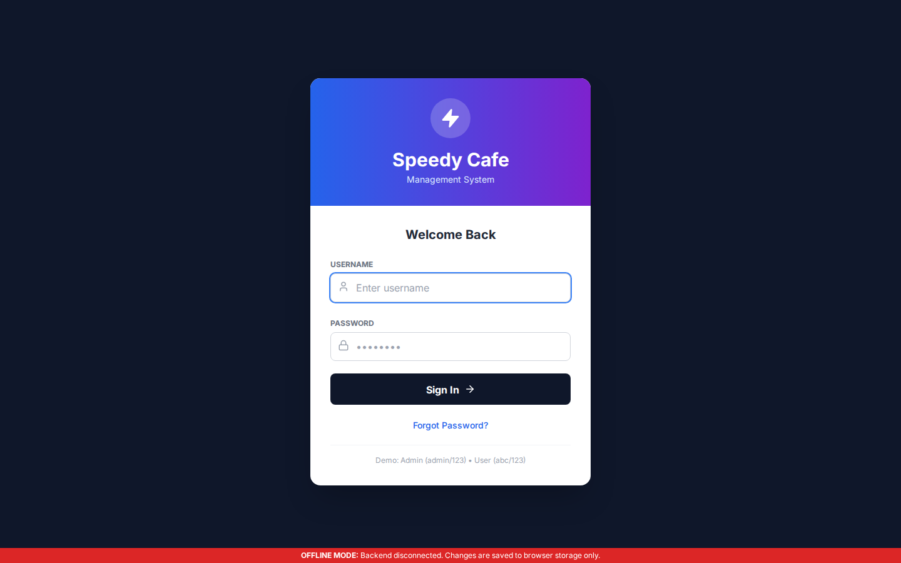

# Speedy Cafe
### Internet Cafe & Gaming Center Management Dashboard

A browser-based management project for internet cafes, gaming lounges, PC cabin businesses, and shared-workstation venues. Built with **React, TypeScript, Vite, PHP, and MySQL**.

> **Development preview, not production-ready.** The browser-only demo uses fictional data and intentionally weak demo credentials. The optional PHP backend now includes server-side sessions, password hashing, CSRF, role checks, and login throttling, but full production deployment and business-data integrity have not been independently validated. **Do not put real customer or financial data in an unreviewed deployment.** See [SECURITY.md](SECURITY.md).

## What you can explore

- **PC/cabin dashboard:** Availability, occupied/on-hold/maintenance status, and session controls.
- **Sessions and billing:** Start, pause, close, and calculate time-based charges.
- **Customers:** Records and outstanding-balance tracking.
- **Operations:** Inventory, repair tickets, expenses, and transactions.
- **Reporting:** Financial visualizations and audit-log UI.
- **Local demo mode:** Browser-based storage lets you explore without a server.
- **Optional authenticated backend:** PHP/MySQL synchronization includes server-side login and session protection. Business data integrity and multi-user consistency still require production validation.

## Who it's for

Cafe owners and operators who want to evaluate a management dashboard; developers interested in contributing to an internet cafe software project. This is an early-stage community project, not a tested point-of-sale or access-control solution.

## Authenticated backend (main branch)

The default build is an **isolated fictional demo**. To connect to a real PHP/MySQL backend, configure `VITE_API_URL=/api.php`, provision a strong administrator using the CLI bootstrap script, and serve PHP and the frontend on the same HTTPS origin. The protected API uses server-side sessions, CSRF validation and role authorization.

**Do not copy demo credentials into a real deployment.** Before upgrading an existing install, back up the database and review the [secure deployment and credential migration guide](docs/SECURE_DEPLOYMENT.md). The older database schema used plaintext seeded passwords; these no longer work against the protected API.

## Try the local demo

Requirements: Node.js 18+ and npm.

```bash
git clone https://github.com/khurramali42/Internet-Cafe.git
cd Internet-Cafe
npm install
npm run dev
```

Open the URL Vite prints in the terminal. To explore the local demo UI, use `admin` / `123` (demonstration only; **never use this on a public deployment**).

## Optional PHP/MySQL server setup

Use the [Secure Deployment Guide](docs/SECURE_DEPLOYMENT.md) for a **new database** or migration from the historical insecure demo database. Configuration includes server-side environment variables, CLI admin provisioning with a 12+ character password, HTTPS and same-origin API hosting. Set `VITE_API_URL=/api.php` at frontend build time.

The **demo** and **authenticated server mode** are different operating modes. Merely enabling a setting in the demo does not turn it into a secure server deployment. The frontend build alone does not host PHP or MySQL.

## Technology

| Layer | Stack |
| --- | --- |
| Frontend | React 18, TypeScript, Vite |
| UI | Lucide icons, Recharts |
| Prototype backend | PHP, PDO |
| Data store | MySQL and browser LocalStorage (demo) |

## Screenshots (local fictional demo data)

The screenshots below were automatically captured from the running React application in a clean browser using built-in fictional demo data. They do **not** imply production security or a hosted live demo.

### Dashboard


### Customer management


### Inventory / stock


### Reports


### Login


Screenshots are reproducible via the [GitHub Actions capture workflow](.github/workflows/demo-screenshots.yml). A safe public hosted demo has not yet been verified.

## Project status and contributing

- **Status:** Early-stage / development preview.
- **Known critical issues:** [Security guidance](SECURITY.md).
- **Roadmap:** See the repository's GitHub Issues.
- **Feedback:** Open an issue describing your venue type, number of PCs, desired features, and any bugs (without personal or financial data).
- **Reuse/licensing:** No open-source license has been granted in this repository yet. Public source visibility alone does not grant permission to redistribute or modify it. The repository owner should choose and add an explicit license before inviting third-party reuse or contributions.

If you run a gaming center or internet cafe, I'd like to hear what workflow would make this product useful for you.
